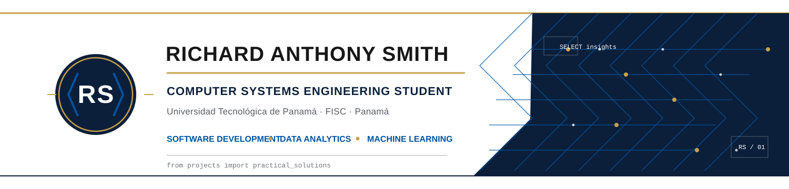

<!-- Personal profile presentation for charrixxz23 -->

  

<h1 align="center">Richard Anthony Smith Alvarado</h1>

  <strong>Computer Systems Engineering Student</strong> 
  Universidad Tecnológica de Panamá · FISC · Panamá

  
  

---

## About Me

I am a student of **Computer Systems Engineering** at the **Universidad Tecnológica de Panamá**. I enjoy building practical technology solutions and applying software development, data analysis, and logical problem-solving to academic and personal projects. My interests include machine learning, computer vision, databases, automation, and the design and administration of technology infrastructure.

## Academic Background

**Universidad Tecnológica de Panamá (UTP)**
Facultad de Ingeniería de Sistemas Computacionales (FISC)
Licenciatura en Ingeniería en Sistemas y Computación · **In progress**

Areas of study and interest include programming and algorithms, software engineering, operating systems, databases, applied statistics, data science, artificial intelligence, and systems architecture and administration.

## Areas of Interest

Software Engineering · Data Analytics · Machine Learning · Artificial Intelligence · Computer Vision · IT Infrastructure · Problem Solving · Data Visualization

## Technologies & Tools

Badges show tools used in coursework and projects; they do not represent certifications or proficiency ratings.

**Programming**

**Data Science**

**Databases**

**Development**

**Infrastructure**

**Computer Vision**

## Featured Projects

<table>
  <tr>
    <td width="104" align="center" valign="top"></td>
    <td valign="top">
      <h3><a href="https://github.com/charrixxz23/Sistema-Predictivo-LPF">Sistema Predictivo para la Liga Panameña de Fútbol</a></h3>
      
Academic project for probabilistic analysis of LPF match outcomes using historical data and statistical and machine-learning models.

      
<strong>Highlights:</strong> 48 pre-match features · chronological validation · Logistic Regression, Random Forest, XGBoost and Poisson · Streamlit · SQLite.

      
<a href="https://github.com/charrixxz23/Sistema-Predictivo-LPF">Repository</a>

    </td>
  </tr>
  <tr>
    <td width="104" align="center" valign="top"></td>
    <td valign="top">
      <h3><a href="https://github.com/charrixxz23/it-infrastructure-monitoring-center">IT Infrastructure Monitoring Center</a></h3>
      
A reproducible, local observability lab for a Docker environment. It is an educational portfolio project, not a production enterprise deployment.

      
<strong>Highlights:</strong> Prometheus · Grafana · Node Exporter · Alertmanager · Docker Compose · incident logging · GitHub Actions.

      
<a href="https://github.com/charrixxz23/it-infrastructure-monitoring-center">Repository</a> · <a href="https://it-infrastructure-monitoring-center.pages.dev/">Documentation site</a>

    </td>
  </tr>
  <tr>
    <td width="104" align="center" valign="top"></td>
    <td valign="top">
      <h3><a href="https://github.com/charrixxz23/vitalbridge">VitalBridge</a></h3>
      
Academic prototype of an IoT gateway for telemedicine kits, designed to store measurements during connectivity interruptions and forward them when service returns.

      
<strong>Highlights:</strong> ESP32 · AD8232 ECG · MAX30102 heart rate and SpO₂ · persistent store-and-forward queue · SQLite · FHIR R4 · simulated intermittent connectivity.

      
<strong>Scope:</strong> Academic prototype; not a certified medical device and not clinically validated.

      
<a href="https://github.com/charrixxz23/vitalbridge">Repository</a> · <a href="https://charrixxz23.github.io/vitalbridge/">Browser demo</a>

    </td>
  </tr>
  <tr>
    <td width="104" align="center" valign="top"></td>
    <td valign="top">
      <h3><a href="https://github.com/charrixxz23/ferreteria-central-demo">Ferretería Central Demo</a></h3>
      
Responsive static web application demonstrating inventory and stock control for a fictional hardware store.

      
<strong>Highlights:</strong> HTML · CSS · JavaScript · Chart.js · stock alerts · sales reports · CSV export.

      
<strong>Scope:</strong> Demonstration for a fictional business.

      
<a href="https://github.com/charrixxz23/ferreteria-central-demo">Repository</a> · <a href="https://charrixxz23.github.io/ferreteria-central-demo/">Demo</a>

    </td>
  </tr>
</table>

## GitHub Activity

For current repositories and contribution activity, visit my [GitHub profile](https://github.com/charrixxz23). The profile's native activity view provides the live record without relying on third-party statistics widgets.

## Contact

- **GitHub:** [github.com/charrixxz23](https://github.com/charrixxz23)
- **LinkedIn:** [linkedin.com/in/richard-anthony-smith-alvarado-4b8a12363](https://www.linkedin.com/in/richard-anthony-smith-alvarado-4b8a12363/)
- **Location:** Panamá

---

*I keep learning, building, and refining practical technology solutions through projects and collaboration.*
